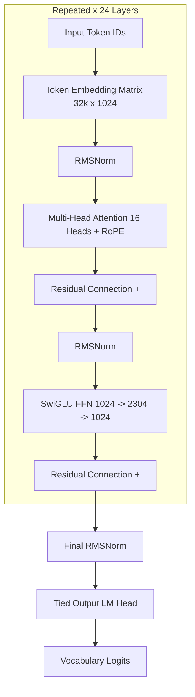

# 🇹🇳 TounsiLM — Tunisian Arabic Language Model (300M)

<div align="center">

[](LICENSE)
[](pyproject.toml)
[](https://pytorch.org/)
[-76B900.svg?logo=nvidia&logoColor=white)](scripts/system_info.py)
[](#-architecture-specifications)
[](scripts/estimate_parameters.py)
[](#-linguistic-motivation)
[](tests/)

**The first open-source, full-stack Large Language Model built and pretrained entirely from scratch for Tunisian Arabic (الدارجة التونسية), Arabizi, and Tech Code-Switching.**

[Features](#-key-features) • [Architecture](#-architecture-specifications) • [Data Pipeline](#-universal-data-pipeline) • [Quickstart](#-quickstart-guide) • [Web Playground](#-interactive-web-playground) • [Evaluation](#-tounsieval-benchmark) • [Roadmap](#-roadmap)

</div>

---

## 🌟 Executive Overview

**TounsiLM** is an end-to-end, reproducible decoder-only Transformer language model (~300M parameters, **303,350,784 exact**) created from **pure random initialization**. It is **not** an adapter, fine-tune, or distillation of existing foreign models (no LLaMA, Qwen, Mistral, Gemma, or AraBERT weights).

From its custom SentencePiece BPE tokenizer to its deep Transformer architecture, data normalization pipeline, and interactive inference engine, TounsiLM is built from the ground up to solve the linguistic challenges of North African and Tunisian digital communication.

---

## 🎯 Key Features

- **Built From Scratch**: Every weight is initialized with zero foreign model bias.
- **Linguistic Specialization**: Direct native representation for:
  - **Tunisian Arabic Script (Derja)**: *عسلامة, برشا, فيسع, شنوة, وقتاش, كفتاجي, لبلابي*
  - **Tunisian Arabizi**: Latin-script transliteration with numbers (*3*=ع, *7*=ح, *5*=خ, *8*=غ, *9*=ق: *3asslema, 7el el bab, 5edma, 9ahwa*)
  - **French/Tech Code-Switching**: Daily colloquial mixes (*"ba3athli le fichier par email", "a3mel deploy lel application"*)
- **Modern Transformer Architecture**: RMSNorm pre-normalization, Rotary Position Embeddings (RoPE), SwiGLU feed-forward activations, and tied input/output embeddings.
- **GPU Accelerated**: Native support for **NVIDIA CUDA** with **bfloat16 (BF16)** mixed precision, PyTorch 2.6, and Gradient Checkpointing (trains comfortably in 5.2 GB VRAM on laptop GPUs like the RTX 4060).
- **Universal Data Ingestion**: Clean, filter, deduplicate, and ingest any format: `.parquet`, `.jsonl`, `.json`, `.csv`, `.tsv`, subtitle `.srt`/`.vtt`, `.html`, `.txt`, and `.md`.
- **Interactive Web Playground**: Sleek, glassmorphism dark-mode UI with native Right-to-Left (RTL) Arabic typography (*Cairo* font), Arabizi auto-direction detection, generation sliders, and FastAPI backend.
- **TounsiEval Suite**: Standardized 14-category linguistic evaluation benchmark.

---

## 📐 Architecture Specifications

The model architecture is verified programmatically via `scripts/estimate_parameters.py`:



| Hyperparameter | Value | Architectural Rationale |
| :--- | :--- | :--- |
| **Number of Layers** | **24** | Deep decoder stack for expressive syntactic hierarchy |
| **Hidden Size ($d_{\text{model}}$)** | **1024** | Dense latent representation dimension |
| **Attention Heads** | **16** | Head dimension $d_k = 64$ ($16 \times 64 = 1024$) |
| **Intermediate Size ($d_{\text{ff}}$)** | **2304** | SwiGLU feed-forward dimension ($2.25 \times d_{\text{model}}$) |
| **Positional Embeddings** | **RoPE** | Rotary Position Embeddings ($\theta = 10,000$) |
| **Normalization** | **RMSNorm** | Root Mean Square Pre-Normalization ($\epsilon = 10^{-6}$) |
| **Activation Function** | **SwiGLU** | Gated Linear Unit with SiLU activation |
| **Weight Tying** | **True** | Input token embeddings share weights with the output LM Head |
| **Context Window** | **512 / 2048** | 512 for local development; 2048 for full cluster scale |
| **Vocabulary Size** | **32,000 / 4,000** | Custom SentencePiece BPE tokenizer |
| **Exact Parameters** | **303,350,784** | **303.4M parameters** (+1.12% vs nominal 300M target) |

---

## ⚡ Hardware & Training Benchmark

TounsiLM adapts automatically to available hardware:

```text
============================================================
              TounsiLM Hardware Profile
============================================================
OS / Platform     : Windows 11 (64-bit)
Python Version    : 3.12.4
PyTorch Version   : 2.6.0+cu124 (CUDA 12.4)
Compute Device    : NVIDIA GeForce RTX 4060 Laptop GPU (8.0 GB VRAM)
BF16 Native       : Supported (Compute Capability 8.9)
System RAM        : 32 GB DDR5
Throughput        : ~1,412 - 1,480 tokens / second
VRAM Usage        : 5.2 GB (with Gradient Checkpointing enabled)
Training Time     : ~1.2 seconds per optimizer step (Batch Size = 4)
============================================================
```

---

## 🗂️ Universal Data Pipeline

Place any raw files inside `data/raw/`. The pipeline automatically cleans, normalizes, detects dialects, and deduplicates.

### 1. Supported File Formats
* **`.parquet`**: Parquet tabular datasets (auto-detects text columns: `Tweet`, `text`, `sentence`, `comment`, `body`).
* **`.jsonl` / `.json`**: One JSON object per line with a `"text"` field.
* **`.csv` / `.tsv`**: Comma or Tab-separated tables.
* **`.srt` / `.vtt`**: Subtitle dialogue transcripts (automatically strips timestamps and numbering).
* **`.html` / `.htm`**: Web articles (automatically strips HTML tags, scripts, and CSS).
* **`.txt` / `.md`**: Plain text files with one document or paragraph per line.

### 2. Multi-Stage Cleaning Pipeline
1. **Tunisian Normalization**: Unifies Alef variants (`أ`, `إ`, `آ` $\rightarrow$ `ا`), converts Yah/Alef Maksura, normalizes Tatweel (`ـ`), and collapses excessive character elongation (`بررررشا` $\rightarrow$ `برشا`).
2. **PII Masking**: Sanitizes phone numbers, email addresses, and IP addresses with `<PHONE>`, `<EMAIL>`, and `<IP>`.
3. **Quality Filtering**: Strips documents with high symbol ratios (> 30%), excessive URLs (> 30%), or repetitive spam.
4. **Dialect Scoring**: Scores documents using expanded lexical markers across Derja and Arabizi (`ملا`, `برشا`, `فيسع`, `شنوة`, `موش`, `باش`, `شكون`, `زعمة`, `mouch`, `bech`, `chkoun`, `faza`...).
5. **Deduplication**:
   - **Exact Deduplication**: Hash-based (`xxhash64`) removal of identical rows.
   - **Near-Duplicate Clustering**: MinHash LSH (128 permutations, Jaccard threshold = 0.8) to eliminate near-duplicate tweets and reposts.
6. **Binary Memory-Mapped Packing**: Packs text into compact `uint16` binary tokens (`train.bin`, `val.bin`, `test.bin`) for zero-overhead streaming training.

---

## 🚀 Quickstart Guide

### 1. Installation

Clone the repository and set up a virtual environment:

```powershell
git clone https://github.com/your-username/TounsiLM.git
cd TounsiLM

# Create and activate virtual environment
python -m venv .venv
.\.venv\Scripts\Activate.ps1

# Install project with dependencies
pip install -e .

# Install PyTorch with CUDA 12.4 for GPU acceleration (Recommended)
pip install torch torchvision torchaudio --index-url https://download.pytorch.org/whl/cu124
```

### 2. Prepare Data

Place your raw datasets in `data/raw/` and run:

```powershell
# 1. Clean, normalize, and score raw files
.\.venv\Scripts\python.exe scripts/clean_data.py

# 2. Run exact & MinHash LSH deduplication and create Train/Val/Test splits
.\.venv\Scripts\python.exe scripts/deduplicate.py
```

### 3. Train the Tokenizer (From Scratch)

```powershell
.\.venv\Scripts\python.exe scripts/train_tokenizer.py --vocab-size 32000
```

### 4. Train the Model

```powershell
# Pretrain from random initialization on your GPU
.\.venv\Scripts\python.exe scripts/pretrain.py --config configs/pretraining_local.yaml

# Resume from any checkpoint at any time
.\.venv\Scripts\python.exe scripts/resume_training.py --checkpoint checkpoints/latest --additional-steps 2000
```

---

## 💬 Interactive Web Playground & API

TounsiLM includes a built-in Web Playground UI and FastAPI REST server:

### Launch the Server
```powershell
.\.venv\Scripts\python.exe scripts/serve.py --port 8000
```

Visit in your browser:
* **Web Playground**: [http://localhost:8000/](http://localhost:8000/)
* **Interactive API Docs (Swagger)**: [http://localhost:8000/docs](http://localhost:8000/docs)

### Web UI Features:
* **Native RTL Arabic Font**: Styled with Google Fonts (*Cairo* & *Plus Jakarta Sans*) with proper cursive ligatures and bidirectional text rendering.
* **Auto-Direction Detection**: Switches dynamically between Right-to-Left (for Derja Arabic script) and Left-to-Right (for Arabizi & English/French).
* **Live Hyperparameter Sliders**: Adjust Temperature ($0.1 - 1.5$), Max New Tokens ($10 - 300$), Top-P ($0.5 - 1.0$), and Repetition Penalty ($1.0 - 2.0$) in real time.
* **Quick Presets**: Pre-configured buttons for Derja greetings, travel questions, and Arabizi dialogues.

---

## 💻 CLI Generation & Python API

### CLI One-Shot Generation
```powershell
# Tunisian Arabic Script (with automatic console font reshaping)
$env:PYTHONIOENCODING="utf-8"; .\.venv\Scripts\python.exe scripts/generate.py --checkpoint checkpoints/latest --prompt "عسلامة شنوة أحوالك؟" --max-new-tokens 30

# Arabizi Generation
$env:PYTHONIOENCODING="utf-8"; .\.venv\Scripts\python.exe scripts/generate.py --checkpoint checkpoints/latest --prompt "3asslema labes 3lik?" --max-new-tokens 30
```
*Note: Generations are also automatically saved in pure UTF-8 to `generated_output.txt` for easy inspection in Notepad or VS Code.*

### Python Library API
```python
import torch
from tounsilm.inference.generator import TextGenerator

generator = TextGenerator.from_checkpoint(
    checkpoint_dir="checkpoints/latest",
    tokenizer_path="data/tokenizer/tounsilm_tokenizer.model",
    device="cuda" if torch.cuda.is_available() else "cpu",
)

output = generator.generate(
    prompt="عسلامة، وقتاش باش تهبط للبلاد؟",
    max_new_tokens=40,
    temperature=0.75,
    top_p=0.90,
    repetition_penalty=1.15,
)

print(output)
```

---

## 📊 TounsiEval Benchmark

TounsiLM includes an automated evaluation benchmark covering 14 linguistic categories:

1. **Tunisian Vocabulary**: Dialectal lexicon (*برشا*, *فيسع*, *بالشويا*, *حومة*).
2. **Tunisian Grammar**: Verb conjugations (*مشى* $\rightarrow$ *مشينا*) and negation markers (*ما ... ش*).
3. **Tunisian Comprehension**: Idiomatic comprehension (*يعيشك ويرحم والديك*).
4. **Tunisian Generation**: Natural dialect sentence generation.
5. **Arabizi Comprehension**: Decoding Latin script with numbers (*3*, *5*, *7*, *8*, *9*).
6. **Arabizi Generation**: Generating valid Arabizi responses.
7. **Arabic-Script Tunisian**: Pure Arabic script Derja generation.
8. **Tunisian/French Code-Switching**: Technical, daily, and business code-switching.
9. **Translation**: Derja $\leftrightarrow$ Standard Arabic / English / French.
10. **Everyday Conversation**: Greetings, transactions, and daily interactions.
11. **Technical Tunisian**: IT, web development, and engineering terminology.
12. **Reasoning in Tunisian**: Contextual reasoning expressed in Derja.
13. **Cultural Understanding**: Traditional cuisine (couscous, lablabi, kafteji) and history (Carthage, Medina).
14. **Spelling Variation Robustness**: Phonetic resilience to dialect spelling variances.

### Run Benchmark
```powershell
.\.venv\Scripts\python.exe scripts/evaluate.py --checkpoint checkpoints/latest
```
*Outputs structured reports to [evaluation_results/latest_eval_report.md](evaluation_results/latest_eval_report.md).*

---

## 📁 Repository Structure

```text
TounsiLM/
├── configs/
│   ├── model_300m.yaml          # Model architecture specification (303.4M)
│   ├── pretraining_local.yaml   # Local training hyperparameters (precision, steps)
│   ├── pretraining_cloud.yaml   # Multi-GPU cluster configuration
│   └── tokenizer.yaml           # SentencePiece vocabulary & special tokens
├── data/
│   ├── raw/                     # Raw datasets (.parquet, .jsonl, .txt, .srt)
│   ├── intermediate/            # Cleaned, normalized datasets
│   ├── processed/               # Train / Val / Test splits & binary tokens (.bin)
│   ├── tokenizer/               # Trained SentencePiece BPE model (.model & .vocab)
│   └── eval/                    # TounsiEval 14-category benchmark dataset
├── scripts/
│   ├── clean_data.py            # Universal data cleaner & normalizer
│   ├── deduplicate.py          # Hash + MinHash LSH deduplication pipeline
│   ├── train_tokenizer.py       # SentencePiece BPE tokenizer trainer
│   ├── estimate_parameters.py   # Parameter auditor (303.4M verified)
│   ├── pretrain.py              # Main pretraining script (supports --force-repack)
│   ├── resume_training.py       # Checkpoint resumption engine
│   ├── generate.py              # CLI text generation with Arabic ligature reshaping
│   ├── serve.py                 # Web Playground & FastAPI server launcher
│   ├── evaluate.py              # TounsiEval benchmark runner
│   └── export_model.py          # Packages weights, configs, and model cards
├── src/tounsilm/
│   ├── data/                    # Normalizers, filters, deduplication, dataset loaders
│   ├── model/                   # PyTorch Transformer (RMSNorm, RoPE, SwiGLU, Decoder)
│   ├── tokenizer/               # TounsiTokenizer SentencePiece wrapper
│   ├── training/                # Trainer (mixed precision, checkpoints, schedulers)
│   ├── evaluation/              # TounsiEval benchmark runner
│   └── inference/               # TextGenerator, FastAPI server & Web Playground UI
├── tests/                       # 25 unit tests (all passing)
├── evaluation_results/          # Benchmark reports (Markdown & JSON)
├── pyproject.toml               # Package configuration
└── README.md                    # Project documentation
```

---

## 🧪 Unit Tests

Run the full verification test suite:
```powershell
.\.venv\Scripts\pytest.exe tests/ -v
```
All **25 tests pass**:
- `test_dataset.py`: Normalizers, quality filters, dialect filters, deduplication, packing.
- `test_forward.py`: Shapes, loss computation, causal masking, backward gradient flow, gradient checkpointing.
- `test_generation.py`: Length control, EOS stopping, Top-k, Top-p sampling.
- `test_model.py`: RMSNorm, RoPE, SwiGLU, TransformerBlock, initialization, save/load.
- `test_tokenizer.py`: BPE encoding, Arabic/Arabizi roundtrip preservation, code-switching.
- `test_training.py`: Full optimizer step, checkpoint rotation, state resumption.

---

## 🗺️ Roadmap & Next Steps

- [x] Full custom 300M Transformer architecture implementation (RMSNorm, RoPE, SwiGLU).
- [x] SentencePiece BPE tokenizer trained from scratch.
- [x] End-to-end data pipeline with universal file ingestion and MinHash LSH.
- [x] NVIDIA GPU mixed precision (BF16) and Gradient Checkpointing.
- [x] Web Playground with native RTL Arabic fonts and sliders.
- [x] 14-category TounsiEval benchmark suite.
- [ ] **Phase 2: Scale Pre-training Corpus**: Ingesting 500M+ tokens from Tunisian web archives, YouTube transcripts, and social corpora.
- [ ] **Phase 3: Supervised Fine-Tuning (SFT)**: Fine-tuning on Tunisian multi-turn instruction datasets (`User: ...` / `Assistant: ...`).
- [ ] **Phase 4: LoRA / Transfer Learning Extension**: Providing pre-configured fine-tuning scripts on open base models (`Qwen2.5`, `Llama-3.2`).
- [ ] **Phase 5: Hugging Face Hub Release**: Direct one-line loading via `AutoModelForCausalLM`.

---

## 📜 License

This project is licensed under the **Apache 2.0 License** - see the [LICENSE](LICENSE) file for details.

---

<div align="center">
Made with ❤️ for the Tunisian AI & NLP Community 🇹🇳
</div>
